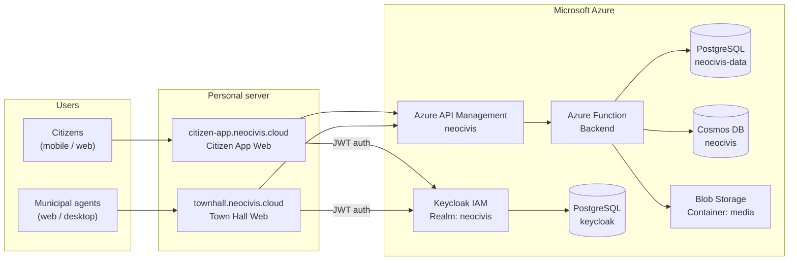
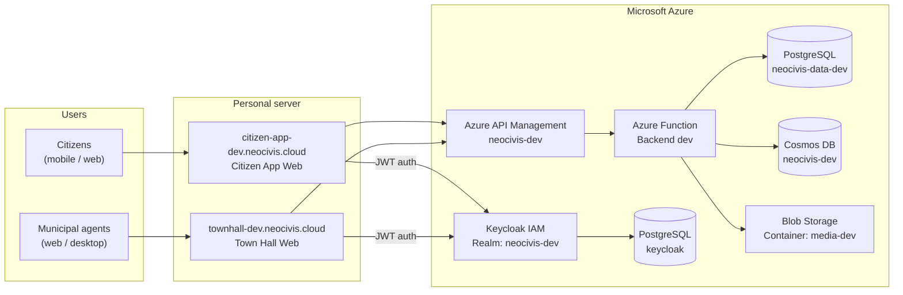

# NeoCivis

**TPI — MIAGE MBDS 2025-2026**

NeoCivis is a municipal services platform that lets citizens submit and track requests to their city, while municipal agents manage them from a dedicated back-office portal. The project is structured as a monorepo containing four applications and several shared packages.

---

## Project Links

| Resource | URL |
|----------|-----|
| Citizen App (production) | https://citizen-app.neocivis.cloud |
| Town Hall Web (production) | https://townhall.neocivis.cloud |
| Citizen App (development) | https://citizen-app-dev.neocivis.cloud |
| Town Hall Web (development) | https://townhall-dev.neocivis.cloud |
| Keycloak IAM | https://auth.neocivis.cloud |

---

## Team

| Member | GitHub | Area & Missions |
|--------|--------|--------|
|[Mouna AAROUR](mailto:mouna.aarour@etu.unice.fr) | [@mounaAar](https://github.com/mounaAar) | Frontend conception and development, design, main-focus on Town Hall Web |
| [Titouan LACOMBE--FABRE](mailto:titouan.lacombre--fabre.etu.unice.fr) | [@Tit0u4N](https://github.com/Tit0u4N) | Global strucutre and frontend applications strucutre setup, CI, frontend conception and development, design, main-focus on Citizen App |
| [Tamas PALOTAS](mailto:tamas.palotas@etu.unice.fr) | [@Shiyamii](https://github.com/Shiyamii) | Backend application strucutre setup, CD setup, Infrastructure conception & setup on Azure & personal server, Keycloak setup, backend conception and development (focus on presistance/strucutre) |
| [Farid ZENNANI](mailto:farid.zennani@etu.unice.fr) | [@Faridzen](https://github.com/Faridzen) | Backend development on the module Report, AI research and implementation |

---

## Description

NeoCivis is a civic platform serving two audiences:

- **Citizens** access the mobile/web app (`citizen-app`) to submit incident reports, read municipal news articles, browse local establishments, and follow up on their requests through threaded discussions.
- **Municipal agents** use the web portal (`town-hall-web`) to manage reports, publish articles, configure establishments, handle media, and administrate users and access rights per city.

Both applications share the same REST API backend, secured via Keycloak JWT tokens. The system supports multiple cities simultaneously, with role-based access control (citizen / employee / admin) scoped per city.

---

## Organization

### Monorepo structure

The project uses **Turborepo** with **bun** as the package manager. All commands run from the monorepo root unless noted otherwise.

```
apps/
├── town-hall-web/      # Municipal back-office portal (Next.js 16 + React 19)
├── citizen-app/        # Citizen mobile & web app (Expo 54 + React Native)
├── keycloak/           # Custom Keycloak auth theme (Keycloakify + React + Tailwind CSS)
└── backend/            # REST API (Hono v4 on Azure Functions v4)

packages/
├── frontend/
│   ├── frontend-core/      # @repo/frontend-core — shared HTTP client, utilities
│   └── frontend-services/  # @repo/frontend-services — reusable business logic services
└── shared/
    ├── typescript-config/  # @repo/typescript-config — shared TypeScript base configs
    ├── contracts/          # @repo/contracts — Zod schemas + DTOs shared by backend and frontend
    └── vitest-config/      # @repo/vitest-config — shared Vitest configuration
```

Shared packages are built before applications via Turborepo's dependency graph (`dependsOn: ["^build"]`). Any change to a shared package requires rebuilding it before apps pick it up.

### Development workflow

- Branches: `main` (production), `develop` (integration), `dev/#issue-name` (features), `fix/#issue-name` (bugs)
- All PRs target `develop` and require approval from **2 reviewers**
- Commits follow [Conventional Commits](https://www.conventionalcommits.org/) (`feat:`, `fix:`, `chore:`, etc.)

See [CONTRIBUTING.md](CONTRIBUTING.md) for full guidelines.

### Common commands

```bash
# Run all apps in dev mode (use carefully, it can be resource-intensive)
bun turbo dev

# Run a single app
bun turbo dev --filter=town-hall-web
bun turbo dev --filter=citizen-app
bun turbo dev --filter=backend

# Build
bun turbo build --filter=<app-or-package>

# Lint (Biome)
bun lint

# Format (Biome)
bun format

# Tests
bun turbo test

# Clean
bun clean
```

---

## Global Architecture

### Application components

The platform is composed of four applications and a set of shared packages:

- **`citizen-app`** — Expo/React Native app for citizens. Runs on mobile (iOS/Android) and web. Citizens authenticate via Keycloak, then consume the `citizen` API surface.
- **`town-hall-web`** — Next.js web app for municipal agents and admins. Authenticates via Keycloak, consumes the `municipality` API surface.
- **`backend`** — Hono v4 REST API on Azure Functions. Exposes three gateways: `citizen` (`/api/citizen/*`), `municipality` (`/api/municipality/*`), and `webhook` (`/api/webhook/*`). All data access goes through this API.
- **`keycloak`** — Custom Keycloakify theme for Keycloak authentication pages (login, password reset, etc.).

### Backend layers

The backend follows a strict 4-layer architecture:

```
Gateway → Controller → Service → Repository
```

| Layer | Responsibility |
|-------|----------------|
| **Gateway** | Azure Function entry point, Hono app, dependency injection wiring |
| **Controller** | Route handler, Zod request validation, DTO mapping — no business logic |
| **Service** | All business logic and use-cases |
| **Repository** | Data access only — multiple implementations (in-memory, Drizzle, Cosmos SDK) |

### Frontend pattern (MVVM)

Both frontend apps follow MVVM with a strict separation per component:

| Layer | File | Responsibility |
|-------|------|----------------|
| **View** | `ComponentName.tsx` | JSX render + animations only |
| **ViewModel** | `useComponentName.ts` | State, effects, event handlers |
| **Model** | `@repo/frontend-services` | Shared data-fetching services |

### Data storage split

| Storage | Data |
|---------|------|
| PostgreSQL (Drizzle) | Users, cities, establishments, access rights, threads |
| Azure Cosmos DB | Articles, reports, config, media metadata |
| Azure Blob Storage | Media files and citizen report uploads |

---

## Deployment

### Production environment



### Development environment



### Two parallel environments

The infrastructure runs **production** and **development** environments side by side. Separation is logical: two Keycloak realms, two PostgreSQL databases, two Cosmos DB databases, two Blob Storage containers, and two separate APIM + Azure Function instances.

### Infrastructure overview

- **Keycloak** runs on an Azure VM and is the single source of truth for identity. All frontends authenticate users through it; the backend validates Keycloak-issued JWT tokens on every API request. Keycloak also sends account lifecycle events (register / update / delete) to the backend webhook to keep the `users` table in sync.
- **Azure API Management (APIM)** sits in front of the Azure Functions, acting as an API gateway (access control, rate limiting, routing, observability).
- **Azure Functions v4** hosts the backend API in serverless mode. Three HTTP triggers cover the three API surfaces: `citizen`, `municipality`, and `webhook`.
- **Azure Database for PostgreSQL (Flexible Server)** stores relational data: `keycloak`, `neocivis-data` (prod), and `neocivis-data-dev` (dev) — all on a single server.
- **Azure Cosmos DB** stores document data (articles, reports, config, media metadata) — one database per environment.
- **Azure Blob Storage** stores media files uploaded by agents — one container per environment.
- **Frontend apps** are hosted on a personal server (Azure Student Plan limits prevented full Azure hosting) under the `neocivis.cloud` domain.
- **Mailpit** runs on the same personal server as a local SMTP interceptor for development emails.

### Deploy the backend (Azure Functions)

The backend is deployed to Azure Functions v4 via the Azure CLI. The build output (`dist/`) produced by `tsup` is deployed directly.

```bash
# Build from apps/backend/
bun run build

# Deploy via Azure CLI
func azure functionapp publish <function-app-name>
```

Environment variables are configured in the Azure Function App settings (equivalent to `local.settings.json` in production).

### Deploy the frontend apps

Both web frontends are deployed as static builds on the personal server behind a reverse proxy.

```bash
bun turbo build --filter=town-hall-web
bun turbo build --filter=citizen-app
```

### Deploy the Keycloak theme

The custom theme is built and deployed as a JAR into the Keycloak `providers/` directory. See [apps/keycloak/README.md](apps/keycloak/README.md) for detailed steps.

```bash
# From apps/keycloak/
bun run build-keycloak-theme
# → produces dist_keycloak/keycloak-theme-for-kc-all-other-versions.jar
```

### Database migrations

Must be do manually.
```bash
# From apps/backend/ — apply Drizzle migrations to PostgreSQL
bun --env-file=.env.local run db:migrate
```

---

## CI/CD

All pipelines run on **GitHub Actions**. The CI must pass before any CD workflow triggers.

### Pipeline overview

```
Push / PR
    │
    ▼
CI (Build & Test)  ──── on: push to main/dev, all PRs
    │   build all packages + apps (Turborepo)
    │   run all tests (Vitest)
    │
    ├─── on main or dev ──▶  CD Backend (Azure Functions)
    │                             build backend (tsup)
    │                             assemble deploy artifact
    │                             deploy → neocivis-function-dev (always)
    │                             deploy → neocivis-functions (main only)
    │
    └─── on main or dev ──▶  CD Frontends (Coolify)
                                  trigger Coolify webhook → town-hall-web
                                  trigger Coolify webhook → citizen-app
                                  (dev or prod webhook based on branch)


Push to main (citizen-app or packages changed)
    │
    ▼
CD Android (debug APK)
    lint + test citizen-app
    expo prebuild → Gradle assembleDebug
    upload artifact + create GitHub Release
```
> **Coolify** is a self-hosted deployment platform running on the personal server. It handles building and serving the frontend apps — GitHub Actions just triggers its webhooks.

### Workflows

| File | Trigger | What it does |
|------|---------|--------------|
| `ci.yml` | Push to `main`/`dev`, all PRs | Install deps, Turborepo cache, build all, test all |
| `cd-azure.yml` | CI passes on `main`/`dev`, or manual dispatch | Build backend with tsup, assemble artifact, deploy to Azure Functions (dev always, prod on `main` only) |
| `cd-coolify.yml` | CI passes on `main`/`dev`, or manual dispatch | Trigger Coolify deploy webhooks for `town-hall-web` and `citizen-app` (selects dev/prod webhook by branch) |
| `cd-citizen-android.yml` | Push to `main` with changes in `citizen-app/` or `packages/`, or manual dispatch | Build debug APK via Gradle, upload artifact, create GitHub Release with the APK |

### Branch → environment mapping

| Branch | Backend | Frontends | Android APK |
|--------|---------|-----------|-------------|
| `main` | prod + dev Function Apps | prod + dev Coolify webhooks | GitHub Release created |
| `dev` | dev Function App only | dev Coolify webhook only | — |
| other | — | — | — |

### Required secrets

| Secret | Used by |
|--------|---------|
| `AZURE_FUNCTIONAPP_PROD_PUBLISH_PROFILE` | `cd-azure.yml` — prod Function App |
| `AZURE_FUNCTIONAPP_DEV_PUBLISH_PROFILE` | `cd-azure.yml` — dev Function App |
| `COOLIFY_API_TOKEN` | `cd-coolify.yml` |
| `COOLIFY_WEBHOOK_TOWN_HALL_PROD` | `cd-coolify.yml` |
| `COOLIFY_WEBHOOK_TOWN_HALL_DEV` | `cd-coolify.yml` |
| `COOLIFY_WEBHOOK_CITIZEN_APP_PROD` | `cd-coolify.yml` |
| `COOLIFY_WEBHOOK_CITIZEN_APP_DEV` | `cd-coolify.yml` |

---

## Technologies

### Language & tooling

| Tool | Version | Role |
|------|---------|------|
| TypeScript | ~5.9.3 | Language (strict mode everywhere) |
| Bun | latest | Package manager |
| Turborepo | 2.6.1 | Monorepo task orchestration with caching |
| Biome | 2.3.8 | Linting + formatting (replaces ESLint/Prettier) |
| Vitest | 4.0.16 | Unit testing |
| Bruno | latest | API testing (collection in `apps/backend/api-tests/`) |

### Apps

| App | Framework | UI | Styling |
|-----|-----------|----|---------|
| `town-hall-web` | Next.js 16 + React 19 | shadcn/ui + @base-ui/react | Tailwind CSS v4 |
| `citizen-app` | Expo 54 + React Native 0.81 | Custom components | React Native StyleSheet + theme system |
| `backend` | Hono v4 + Azure Functions v4 | — | — |
| `keycloak` | Keycloakify v11 + React 19 | @base-ui/react | Tailwind CSS v4 |

### Backend dependencies

| Package | Role |
|---------|------|
| `@marplex/hono-azurefunc-adapter` | Bridges Hono with Azure Functions runtime |
| `drizzle-orm` + `postgres` | PostgreSQL ORM |
| `@azure/cosmos` | Azure Cosmos DB SDK |
| `@azure/storage-blob` | Azure Blob Storage SDK |
| `groq-sdk` | Groq AI — report analysis |
| `zod` | Schema validation (shared with frontend via `@repo/contracts`) |

### Cloud infrastructure

| Service | Usage |
|---------|-------|
| Azure Functions v4 | Serverless backend API |
| Azure API Management | API gateway (auth, rate limiting, routing) |
| Azure Database for PostgreSQL | Relational data (users, cities, establishments, threads, access) |
| Azure Cosmos DB | Document data (articles, reports, config, media metadata) |
| Azure Blob Storage | Media file storage |
| Azure VM | Keycloak IAM server |
| Keycloak | Identity and access management (JWT issuance, realms, webhooks) |

---

## Default Users

See [DEFAULT_USERS.md](DEFAULT_USERS.md) for the default seed accounts (citizens, employees, admins) and their credentials.

---

## Further Reading

| Document | Description |
|----------|-------------|
| [apps/backend/README.md](apps/backend/README.md) | Backend setup, environment variables, database commands, seeding, API routes, testing |
| [apps/keycloak/README.md](apps/keycloak/README.md) | Keycloak theme development and deployment |
| [CONTRIBUTING.md](CONTRIBUTING.md) | Branch strategy, commit conventions, PR process |
| [DEFAULT_USERS.md](DEFAULT_USERS.md) | Default seed users for local and dev environments |
